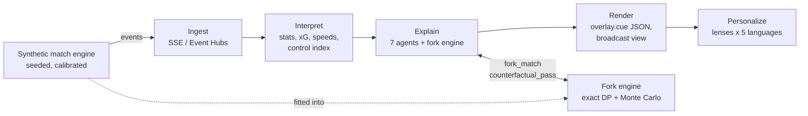

# Forkcast

**Every moment, replayed a thousand ways, so the broadcast can prove why it mattered.**

Forkcast turns synthetic football events into explainable match intelligence for studio, broadcast and streaming. Most match graphics show *what* happened. Forkcast measures *why it mattered*: at every key moment it freezes the match and replays the rest of it, then puts the measured swing on screen, in five languages, shaped for each kind of fan.

Built for the Microsoft × Premier League **Inside the Game** hackathon.

> **Synthetic data only.** Every club, player, league and match in this repository is fictional and generated by the Forkcast engine. No real match data, footage, names or marks are used.

---

## What makes it different

Most "explainable" match AI writes a plausible reason and checks that the cited events exist. Forkcast **tests** the reason:

1. **One world model.** The same engine that generates the match is fitted into a Markov model of the game (team in possession × pitch zone → next state). Data, forecasts and explanations come from one world, so they cannot contradict each other.
2. **Exact and sampled futures.** A backward dynamic program gives the *exact* joint distribution of both teams' remaining goals from any state (solved once per fixture in about 0.13 s). A vectorised Monte Carlo sampler plays 1,000 futures as an independent check. They agree: pre-match home win 42.1% exact vs 43.7% from 1,000 forks vs 45.0% across 500 real engine matches.
3. **Predictions in plain words.** From that one solve, Forkcast describes the rest of the match: the most likely final scores, who is likelier to score next, the chance of a goal in the next 10 minutes, and exactly what the trailing side needs ("Port Amberly need a goal in 43 minutes and come back to draw or win 28% of the time. Most likely finish: 2–1 (27%).").
4. **A Skeptic that blocks unproven claims.** Every number on screen must appear in the evidence, every event id must exist, and superlatives need proof. "That could be the turning point of the match" only airs if the swing is at least 15 points *and* the largest of the match so far.

## Features

| Feature | What the viewer sees |
| --- | --- |
| **Moment Impact** | Goal, big chance and turnover cards with the measured win-probability swing (e.g. 33% → 60%), proven by 1,000 forks, plus a "what it means" line: what the trailing side now needs and the most likely final score |
| **Forecast panel** | Live, descriptive prediction every match minute: win/draw/loss, the four most likely final scores, who scores next, goal in the next 10 minutes, expected goals still to come; periodic "Match outlook" cards on screen |
| **5 Hz tracking** | A physical layer for all 22 players and the ball: receivers run onto passes, the nearest defenders press, long balls and crosses fly in an arc, each side holds a shape that slides with play |
| **Futures River** | A live river of win, draw and loss probability, solved exactly from every state; goals snap it, hover any marker for the explanation |
| **Play the Moment** | Freeze the match, click anywhere to play your own pass, and see it replayed through 2,000 futures against what really happened and the best option the engine found |
| **Pundit Duel** | Two pundit agents ("The Purist" vs "The Direct One") argue the same moment; the simulator rules with points per 100 repetitions |
| **Agent Newsroom** | The seven-agent pipeline live: Spotter → Analyst → Simulator → Narrator → Skeptic → Director → Localizer, with rejections, holds and timings |
| **Fork Inspector** | Click any newsroom card to see the 1,000 futures behind it as a goal-difference histogram, before vs after |
| **Lenses** | Casual fan, Analyst, Club fan (framed for each club's supporters), and Player Focus (follows one player) |
| **Five languages** | English, French, Spanish, Portuguese and Nigerian Pidgin (Naijá), with optional spoken commentary |
| **Player identification** | Name tag on the player on the ball and on the focus player; speed tags pop up whenever a player passes 30 km/h; distance and top-speed leaders from tracking |
| **Physical tags** | Shot speed, top sprint speed, distance covered, pass difficulty and completion probability, with "match record" tags |
| **Control vs Chaos** | A five-minute rhythm index from chain length, turnover rate and pressure; agents call phase shifts |
| **Recap Factory** | Full-time recap in every language with moments ranked by measured swing, plus machine-readable highlights |
| **Overlay contract** | Timed `overlay.cue` JSON a graphics partner can render ([docs/overlay-cue.md](docs/overlay-cue.md)) |
| **MCP server** | The fork engine as tools for GitHub Copilot agent mode or Foundry agents: `fork_match`, `counterfactual_pass`, `verify_claim`… |

## The five stages



| Stage | Where |
| --- | --- |
| Ingest | `forkcast/server.py` streams events live (`/api/live`, server-sent events); `forkcast/bus.py` mirrors them to Azure Event Hubs when configured |
| Interpret | `forkcast/interpret.py`: possession, xG, passes, pass difficulty, records, control vs chaos; `forkcast/tracking.py`: 5 Hz positions, speeds and distances |
| Explain | `forkcast/agents.py` (seven agents) on `forkcast/forks.py` and `forkcast/analysis.py` |
| Render | `web/` broadcast client; `overlay.cue` contract |
| Personalize | Lenses and languages in `forkcast/i18n.py` and `forkcast/agents.py` |

## The agents

| Agent | Job | Example from a real run |
| --- | --- | --- |
| Spotter | Flags candidate moments with cheap rules (no model per event) | "Flagged turnover [e00430]: ball won 73 m up the pitch." |
| Analyst | Chooses the experiment that would show why it matters | "Re-run the state as if the shot had gone in." |
| Simulator | Runs it on the fork engine | "Port Amberly 62% → 83% (+21.6 pts)." |
| Narrator | Writes every lens and language from the evidence | "So close! Nico Moreau's shot is blocked…" |
| Skeptic | Rejects unsupported numbers, ids and superlatives | "Rejected: 'turning point' must be the biggest swing so far; 18.2 pts is below the 38.2 pts measured earlier." |
| Director | Broadcast grammar: priority, pacing, overlay type | "Held: screen busy (last card 46 s ago)." |
| Localizer | Delivers five languages × four lenses | "Delivered 5 languages × casual, analyst, club and player lenses." |

Failure recovery: if a model rewrite fails or is rejected, the deterministic template airs; if a moment is not newsworthy, the Simulator drops it with a reason; if the screen is busy, the Director holds it. The match never stops.

## Synthetic data, validated

`python -m scripts.validate 500` simulates 500 matches across all 30 fixtures and checks them against typical top-flight bands (tracking metrics on a 12-match sample) ([docs/validation.json](docs/validation.json)):

| Metric | Forkcast | Target band |
| --- | --- | --- |
| Goals per match | 2.90 | 2.4–3.1 |
| Shots per team | 14.4 | 10–16 |
| Shots on target share | 33.7% | 30–40% |
| Pass completion | 87.0% | 76–88% |
| Passes per team | 472 | 300–520 |
| Fouls per match | 22.3 | 18–27 |
| Yellow cards per match | 3.8 | 2.5–5 |
| Home win share | 37.4% | 36–52% |
| Draw share | 24.2% | 18–32% |
| Distance per outfield player (tracking) | 9.7 km | 9–12 km |
| Top speed in a match (tracking) | 35.8 km/h | 30–37 km/h |

All eleven pass. xG is calibrated (goals ≈ 0.94 × total xG). The event schema is in [docs/schema.md](docs/schema.md). Six fictional clubs have their own style vectors (quality, press, directness, width, tempo, finishing), so a pressing side really does win the ball higher up.

## Quick start

Windows (PowerShell):

```powershell
.\run.ps1
```

macOS / Linux:

```bash
./run.sh
```

Or by hand:

```bash
python -m venv .venv
.venv\Scripts\activate          # Windows;  source .venv/bin/activate on macOS/Linux
pip install -r requirements.txt
python -m uvicorn forkcast.server:app
```

Open http://127.0.0.1:8000. The match kicks off automatically. Use **from** to jump to a minute, **Space** to pause, **P** to freeze for Play the Moment.

Run the tests: `python -m pytest -q` (16 tests: engine determinism and calibration, exact-vs-Monte-Carlo agreement, forecast consistency, physically plausible tracking, Skeptic rules, every on-screen number is evidence, API and full live stream).

## Microsoft technology

Honest status as of this commit:

| Technology | Status |
| --- | --- |
| GitHub + GitHub Actions | CI runs calibration and tests on every push (`.github/workflows/ci.yml`) |
| GitHub Copilot agent mode + MCP | `forkcast/mcp_server.py` exposes 11 tools (including `forecast` and `physical`); `.vscode/mcp.json` wires it into VS Code |
| Microsoft Foundry / Azure OpenAI | Optional Narrator rewrite (`forkcast/llm.py`), verified by the Skeptic before airing; set `AZURE_OPENAI_ENDPOINT` and `AZURE_OPENAI_DEPLOYMENT` |
| Azure Container Apps | `azure.yaml` + `infra/main.bicep` + `Dockerfile` for `azd up` (scale to zero, managed identity) |
| Azure Event Hubs | `forkcast/bus.py` publishes the live event stream when `EVENTHUB_CONNECTION_STRING` is set |
| Microsoft Agent Framework / Foundry Agent Service | Planned: host the seven agents as a Foundry workflow calling the MCP tools |
| Microsoft Fabric | Planned: Event Hubs → Eventstream → Eventhouse for the open synthetic dataset |
| Azure AI Speech | Planned; the browser's speech engine is used today for the Voice toggle |

## API

| Endpoint | Purpose |
| --- | --- |
| `GET /api/live?home&away&seed&speed&skip` | Live pipeline as server-sent events on a steady match clock: `meta, track (5 Hz frames), event, trace, cue, outlook (with forecast text), stats (with physical), recap, end`, all stamped with match time `T` |
| `POST /api/control` | Pause, resume or change speed of a live session |
| `GET /api/impact?…&event_id&n` | Exact outlook before/after a moment plus n forks |
| `POST /api/play` | Play the Moment: your pass to (x, y), replayed through 2,000 futures |
| `GET /api/duel?…&event_id` | Pundit Duel with the simulator's verdict |
| `GET /api/recap?…&lang` | Full-time recap in `en, fr, es, pt, pcm` |
| `GET /api/match?…&events=true` | Match metadata and the full event log |
| `GET /api/validation` | The calibration report |

## Repository

```
forkcast/      engine.py  tracking.py  forks.py  forecast.py  analysis.py  interpret.py  agents.py  i18n.py  llm.py  bus.py  server.py  mcp_server.py  world.py
web/           index.html  app.js  styles.css      broadcast client, no build step
scripts/       validate.py                           calibration against football norms
tests/         test_forkcast.py
docs/          schema.md  overlay-cue.md  validation.json
infra/         main.bicep  main.parameters.json     Azure Container Apps
```

## Guardrails

Synthetic data only · fictional clubs, players and league · no betting framing (win probability is presented as a match outlook) · every on-screen claim carries an event id and passes the Skeptic · model output is always re-verified · clear statement of what is simulated.

## License

MIT. See [LICENSE](LICENSE). This project follows the [Microsoft Open Source Code of Conduct](CODE_OF_CONDUCT.md).
